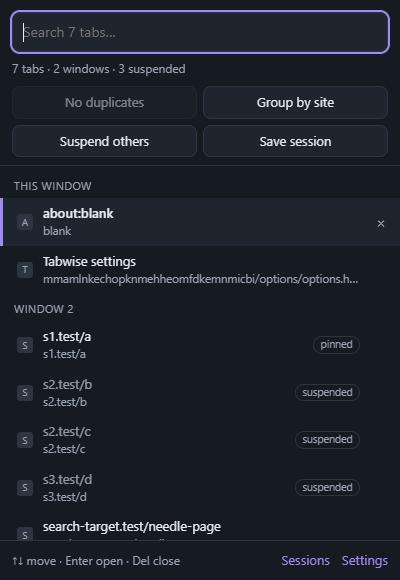
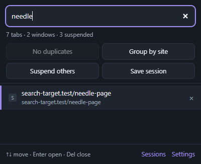

# Tabwise: Smart Tab Manager

**Find any tab in a second, close duplicates, group tabs by site, free memory from idle tabs, and save sessions to reopen later.**
Free, open source, offline. No accounts, no tracking, no network requests.

<p>
  
  
</p>

Part of the [Free Tools Ecosystem](https://github.com/Sushang-Agnihotri/free-tools-ecosystem).

## Features

- **Tab search:** press <kbd>Alt</kbd>+<kbd>Shift</kbd>+<kbd>T</kbd>, type a few letters of a title or address, and press <kbd>Enter</kbd> to jump to the tab, even in another window. <kbd>Del</kbd> closes the highlighted tab.
- **Duplicates:** the toolbar badge counts tabs that show the same page. One click closes the extras and keeps the copy you used most recently (pinned tabs are never closed). Optionally, opening a page that's already open switches you to it instead.
- **Groups:** *Group by site* tidies a window in one click. Rules let you send sites into named, coloured groups, for example *github.com → Code*. Grouping can also happen automatically once a site has a few tabs. *(Chrome, Edge and Brave.)*
- **Suspending:** tabs you haven't used for a while (default 1 hour) are unloaded from memory using the browser's own tab discarding. They stay in your tab strip and reload when clicked. Pinned tabs, tabs playing sound, the current tab and sites you exclude are never suspended. *Suspend others* does it immediately.
- **Sessions:** save a window, or all windows, and reopen it later with pins and groups intact. Restored tabs don't load until you click them, so a 50-tab session opens instantly. Automatic snapshots every 10 minutes (the last 5 are kept) let you recover after a crash. Sessions can be exported to and imported from a file.

## Install

### Chrome, Edge, Brave

1. Download `tabwise-<version>-chromium.zip` from the [latest release](https://github.com/Sushang-Agnihotri/tabwise/releases/latest) and unzip it to a folder you'll keep.
2. Open `chrome://extensions` (or `edge://extensions`).
3. Turn on **Developer mode**, click **Load unpacked** and choose the unzipped folder.
4. Optional: pin Tabwise to the toolbar, and change its shortcut at `chrome://extensions/shortcuts`.

### Firefox (experimental)

Download `tabwise-<version>-firefox.zip`, open `about:debugging#/runtime/this-firefox`, click **Load Temporary Add-on…** and choose the zip. Search, duplicates, suspending and sessions work. Tab groups don't, because Firefox 128 has no tab-groups API for extensions. Temporary add-ons are removed when Firefox restarts.

**Requirements:** Chrome, Edge or Brave 121 or newer, or Firefox 128 or newer. Windows, macOS or Linux.

## Privacy

Tabwise works entirely on your device. It has no servers, no analytics and no network requests. Favicons in the popup come from the browser's own local cache. Saved sessions and settings stay in your browser's local storage. Full policy: [PRIVACY.md](PRIVACY.md).

| Permission | Why |
|---|---|
| `tabs` | Read tab titles and addresses for search, duplicates and sessions. Browsers label this "read your browsing history", but Tabwise only looks at the tabs you have open and never sends them anywhere. |
| `tabGroups` | Create and update tab groups (Chromium) |
| `storage` | Keep settings and saved sessions |
| `alarms` | Check for idle tabs and autosave in the background without staying awake |
| `favicon` | Show site icons from the browser's cache (Chromium) |

## Limitations

- **Suspended tabs reload when clicked.** Unsaved text in a form on a suspended page may be lost, as with the browser's own memory saver. Add sites where you type a lot (email, documents) to *Never suspend*.
- **Duplicates are matched by exact address** (ignoring `#section` by default). Two addresses that show the same content, like a page with and without tracking parameters, count as different.
- **Sessions store addresses, not page contents.** Pages are loaded fresh when restored.
- **Browser pages** (`chrome://`, `about:`) can't be suspended or saved in sessions.

## Performance

Tabwise does nothing while you browse. It reacts to tab events, and two lightweight alarms run in the background: an idle-tab check every 15 minutes at the default setting (never more often than every 5), and the autosave every 10 minutes, which writes only when your tabs changed. The browser unloads its background worker when idle. In the test session the worker used about 1 MB of memory while active. The download is about 23 KB, with no third-party libraries.

## Troubleshooting

**The shortcut doesn't work.** Another extension may use <kbd>Alt</kbd>+<kbd>Shift</kbd>+<kbd>T</kbd>. Set a different one at `chrome://extensions/shortcuts`.

**A tab I'm using keeps getting suspended.** Add its site under *Settings → Suspending → Never suspend these sites*, or choose a longer delay.

**I closed a window by accident.** Open *Sessions* and choose the latest *Autosave*, or use the browser's own history (<kbd>Ctrl</kbd>+<kbd>Shift</kbd>+<kbd>T</kbd>).

## Uninstall

Remove Tabwise from `chrome://extensions` or Firefox's Add-ons page. Export your sessions first if you want to keep them. Uninstalling deletes all of Tabwise's data. Suspended tabs stay where they are and reload normally.

## Build from source

```bash
npm install        # test tools only (puppeteer-core)
npm run build      # → build/chromium, build/firefox, dist/*.zip
npm test           # unit tests
npm run test:e2e   # end-to-end tests with real tabs in Chrome
```

## License

[MIT](LICENSE)
